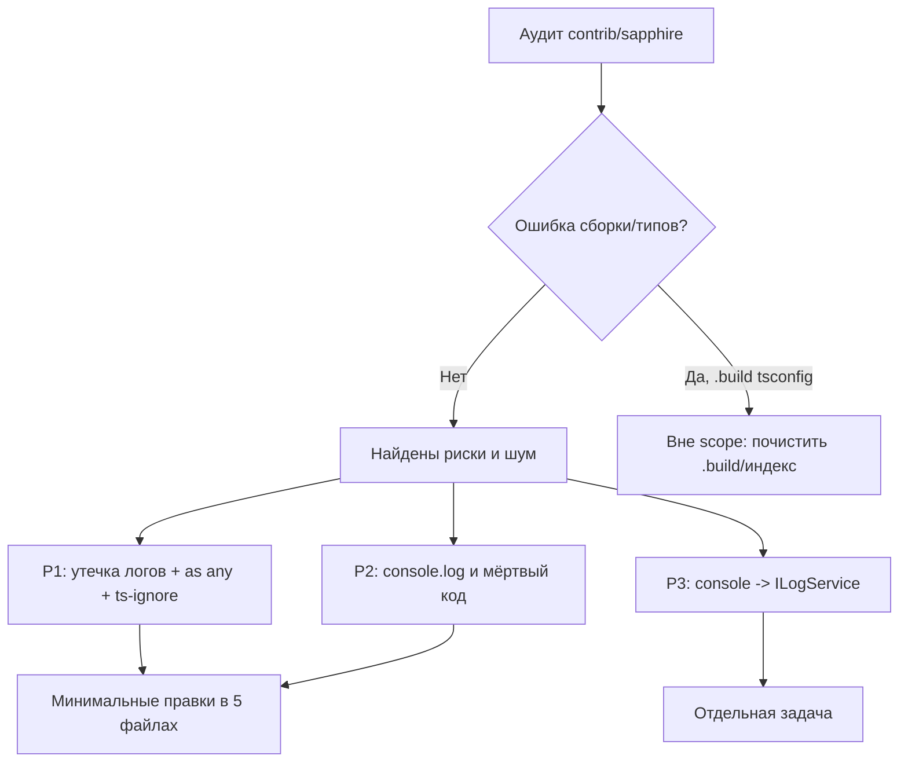

## Аудит проекта на ошибки — `src/vs/workbench/contrib/sapphire`

### Границы (scope)
- Только код внутри `src/vs/workbench/contrib/sapphire`.
- Файлы вне этого каталога не трогаем (в т.ч. `.build/**` и генерируемые `vue/src2/**`, `vue/out/**`).
- Цель — исправить реальные риски минимальным диффом, без рефакторинга архитектуры.

---

### 1. Что реально «сломано»

**Ошибок компиляции/типов в контрибе не обнаружено.** Проверены диагностики workspace и отдельных файлов (`chatThreadAgentLoop.ts`, `sapphireSettingsService.ts`) — чисто.

Единственные ошибки в workspace:

- `.build/.../extensions/open-remote-ssh/tsconfig.json`
- `.build/.../extensions/open-remote-wsl/tsconfig.json`
- `.build/extensions/open-remote-ssh/tsconfig.json`
- `.build/extensions/open-remote-wsl/tsconfig.json`

Все четыре: `Cannot read file '.../extensions/tsconfig.base.json'`. Это артефакты сборки под `.build/` (их не должно быть в индексе) — **вне зоны правок**, но стоит переиндексировать/почистить `.build`.

`vue/src2/**` и `vue/out/**` — генерируемые каталоги (`build.js` пересоздаёт `src2` из `src`, оба в `.gitignore` и `.eslint-ignore`). Это **не дубликаты-ошибка**, трогать не нужно.

---

### 2. Находки по категориям

#### P1 — Реальные риски

**2.1. Логирование содержимого файлов пользователя в консоль (утечка)**
- `browser/editCodeSearchReplace.ts:353-358` — в ошибке печатается весь контент: `console.log('originalFileCode', { originalFileCode })`, `console.log('fullText', { fullText })`, `console.log('block.orig:', block.orig)`. Это содержимое кода рабочей области в devtools/логи.
  → Убрать печать тел, оставить один безопасный маркер ошибки (или `ILogService` без содержимого).

**2.2. Небезопасные приведения типов (`as any`)**
- `browser/chatThreadAgentLoop.ts:1051,1126,1127` — `callTool[toolName](toolParams as any)` и `stringOfResult[toolName](toolParams as any, toolResult as any)`. Причина — динамический `toolName: ToolName`, из-за чего union функций не вызывается. `ToolName = BuiltinToolName | (string & {})` (`common/toolsServiceTypes.ts:267`).
  → Сузить до `BuiltinToolName` там, где ветка `isBuiltInTool`, либо ввести generic-хелпер, сохраняющий связь `params`/`result` с ключом тула (типы `ToolCallParams<T>` / `ToolResult<T>` уже есть).
- `common/sapphireSettingsService.ts:471` — `{...} as any` при merge дефолтов провайдера.
  → Типизировать через `ProviderName`/`SettingsOfProvider` без `any`.
- `electron-main/llmMessage/sendLLMMessage.impl.ts:632` — `messages: messages as any` для OpenAI SDK.
  → Использовать корректный тип сообщений SDK (`OpenAI.Chat.Completions.ChatCompletionMessageParam` или внутренний тип + маппер).

**2.3. Подавления проверок**
- `electron-main/llmMessage/sendLLMMessage.impl.ts:6` — `/* eslint-disable */` на весь файл.
- `electron-main/llmMessage/sendLLMMessage.impl.ts:744` — `// @ts-ignore`.
  → Сузить/убрать, заменив на корректную типизацию (в файле уже есть локальные типы для стрима).

#### P2 — Гигиена/шум
- Отладочные логи в проде:
  - `browser/editCodeWriteover.ts:415` — `console.log('called onDone')`
  - `browser/editCodeDiffZones.ts:252` — `console.log('MOUNTED CTRLK', ...)`
  - `electron-main/sapphireUpdateMainService.ts:42` — `console.log('updateState', ...)`
  - `electron-main/sendLLMMessageChannel.ts:80,103` — `console.log('llmMessageChannel: Call Error:', e)`, `console.log('sendLLM: firing err')`
- Закомментированный legacy-код: `common/sapphireSettingsService.ts:457-459` (`// legacy merge — похоже на баг`) и `browser/sapphireSettingsPane.ts:105` (старый `setTimeout`-костыль).
  → Удалить мёртвый код (без изменения поведения).
- `browser/sapphireSCMService.ts:174,228` — `(r: any)`, `onError(error: any)`.
  → Типизировать (SCM-ресурс/`Error`).

#### P3 — Опционально (не блокеры)
- `console.log/warn/error` в `common/mcpService.ts`, `electron-main/mcpChannel.ts`, `electron-main/llmMessage/sendLLMMessage.ts`, `common/sapphireModelService.ts`, `browser/autocompleteService.ts`, `browser/editCodeSearchReplace.ts` и др. В кодовой базе VSCode принято писать через `ILogService`.
  → Перевод на `ILogService` — отдельная задача (много файлов), предлагаю **не** включать в этот проход, кроме P1-логов из 2.1.
- `any` в IPC-интерфейсах каналов (`sendLLMMessageChannel.ts:68`, `mcpChannel.ts:94,351,399`, `officeExtractChannel.ts:17,21`) — стандартная практика для `IChannel`, трогать не обязательно.

---

### 3. Схема принятия решения

---

### 4. Порядок работ (что менять)

1. `browser/editCodeSearchReplace.ts` (353-358) — убрать печать `originalFileCode`/`fullText`/`block.orig`.
2. `browser/editCodeWriteover.ts` (415), `browser/editCodeDiffZones.ts` (252), `electron-main/sapphireUpdateMainService.ts` (42), `electron-main/sendLLMMessageChannel.ts` (80, 103) — удалить/заменить отладочные логи.
3. `browser/chatThreadAgentLoop.ts` (1051, 1126-1127) — убрать `as any` через сужение/generic по `ToolName`.
4. `common/sapphireSettingsService.ts` (471) — типизировать merge; (457-459) — удалить legacy-комментарий.
5. `electron-main/llmMessage/sendLLMMessage.impl.ts` (6, 632, 744) — снять `eslint-disable`/`@ts-ignore`, типизировать `messages`.
6. `browser/sapphireSCMService.ts` (174, 228) — типизировать.
7. `browser/sapphireSettingsPane.ts` (105) — удалить мёртвый комментарий.

Никаких изменений вне `contrib/sapphire`. Семантику поведения не меняем — только типы, логи, мёртвый код.

### 5. Риски

- `sendLLMMessage.impl.ts` — файл-«сборная солянка» с `eslint-disable`; снятие подавления может вскрыть много новых lint-ошибок. Если их окажется много — откатить на локальный `eslint-disable-next-line` с комментарием.
- `chatThreadAgentLoop.ts` — динамический вызов тулов; неверное сужение типа может сломать вызов MCP-тулов. Проверять обе ветки (`isBuiltInTool` и MCP).
- Удаление логов не должно затрагивать логику ретраев `editCodeSearchReplace`.

### 6. Проверка (ручной smoke-чеклист, т.к. автотесты не запускаем)

- Settings → все вкладки (Models, Providers, MCP, Rules, Skills) открываются, настройки сохраняются.
- Чат: отправить сообщение, получить ответ (Anthropic/Gemini/OpenAI-compatible).
- Apply edit: намеренно вызвать ошибку search/replace → в консоли **нет** содержимого файла, есть только текст ошибки.
- MCP: подключить сервер, вызвать инструмент.
- Обновление: окно открыто 5+ секунд, проверка апдейта не падает.
- `vue/src2` пересобирается `node build.js` без изменений (не в git).

### 7. Открытые вопросы

- Нужно ли переводить **все** `console.*` на `ILogService` (P3) в этом же проходе или отдельной задачей?
- Ограничиться P1 или включать P2?
