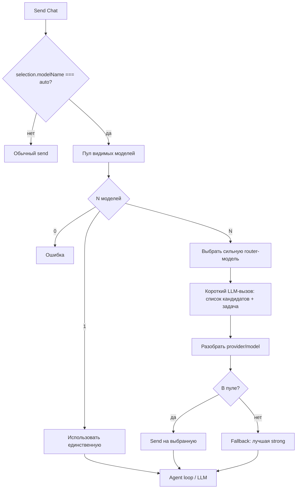

# Режим Auto

Локальный роутер моделей Sapphire (не Copilot `POST /auto`). Пользователь выбирает **Auto** в пикере Chat; перед LLM-ходом агента выбирается конкретная `{ providerName, modelName }`.

## Схема



## Ключевые файлы

| Файл | Роль |
| --- | --- |
| `common/autoModeRouter.ts` | partition / pickRouter / parse / промпты |
| `common/sapphireSettingsTypes.ts` | `SAPPHIRE_AUTO_*`, `isAutoModelSelection` |
| `common/sapphireSettingsService.ts` | Auto первой в `_modelOptions`; фильтр только Chat |
| `browser/chatThreadAgentLoop.ts` | `_resolveAutoModelForRun` перед LLM |

## Sentinel

- `modelName === 'auto'` → Auto.
- `providerName` у опции Auto — placeholder (`deepseek`), **игнорируется** при роутинге.
- Auto есть только у feature **Chat**; Ctrl+K / Apply / SCM / Autocomplete — явная модель.

## Пул и тиры

Пул: все **включённые** провайдеры и **видимые** (`!isHidden`) модели из `_modelOptions` (DeepSeek, Kimi, …).

`STRONG_CONTEXT_THRESHOLD = 512_000`:

- **strong** — `contextWindow ≥ 512K` (DeepSeek flash/pro, Kimi K3…);
- **simple/mid** — ниже порога (DeepSeek chat/reasoner 128K, Kimi K2 262K).

`pickRouterModel`: max `contextWindow` среди strong; при равенстве предпочитает id с `highspeed` / `flash` / `fast`; иначе lexicographic `providerName/modelName`.

## Ответ роутера

Только JSON:

```json
{ "providerName": "deepseek", "modelName": "deepseek-flash" }
```

Id строго из переданного списка. Невалидный ответ / таймаут (~8 с) → fallback на лучшую strong.

Reasoning у роутера выключается только если `canTurnOffReasoning` (у Kimi K3 сейчас нельзя — роутер идёт as-is).

## Кэш на прогон

Выбранная модель фиксируется на **весь agent-run**. Кэш на thread:

- новый user-turn → роутинг заново;
- продолжение после Approve tool / subagent → reuse кэша.

## Per-thread пикер

Выбор Auto (или конкретной модели) в сайдбаре хранится на **треде** (`thread.state.modelSelection`), как `chatMode`. Смена модели в другом чате не перетирает Auto в текущем. Новый чат копирует resolved модель текущего. Settings → Chat по-прежнему пишет глобальный fallback `modelSelectionOfFeature.Chat` для старых тредов без поля.

## Подпись в чате

На первом видимом ответе нового user-turn, если в пикере был Auto, над текстом строка `Auto → {displayName}` (`getModelDisplayName`). Пока LLM-роутер выбирает модель, у индикатора «Думаю» статус «Auto выбирает модель…». Следующие tool-ходы того же прогона, Approve и subagent строку не повторяют. Явная модель в пикере подпись не показывает.

## Вне скоупа v1

- Тиры Cursor (`efficiency` / `balance` / `intelligence`).
- Auto для Autocomplete / Ctrl+K / Apply / SCM.
- Copilot CAPI Auto.
- Смена модели mid-run внутри agent loop.
