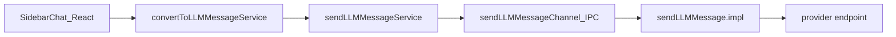

# LLM pipeline

Сообщение из сайдбара до провайдера проходит цепочку сервисов.

## Зачем main process

Отправка из **electron-main**:

- обход CSP renderer при работе с провайдерами;
- удобный доступ к `node_modules` (OpenAI-совместимый клиент);
- единая точка обработки HTTP-ошибок 401 / 408 / 429.

## Ключевые файлы

| Файл                                              | Роль                                                                                                                               |
| ------------------------------------------------- | ---------------------------------------------------------------------------------------------------------------------------------- |
| `convertToLLMMessageService.ts`                   | сборка messages, tools, instructions, `.rules` / `.skills`; trim контекста по unicode-оценке токенов (`estimateTokens.ts`) |
| `sendLLMMessageService.ts`                        | browser API                                                                                                                        |
| `sendLLMMessageChannel.ts`                        | IPC                                                                                                                                |
| `electron-main/llmMessage/sendLLMMessage.impl.ts` | OpenAI-совместимый HTTP; Anthropic и Gemini рядом                                                    |
| `modelCapabilities.ts`                            | capabilities модели (FC, FIM, reasoning)                                                                                           |

## Провайдеры

OpenAI-совместимые провайдеры идут через общий клиент, base URL из настроек. Anthropic и Gemini — отдельные отправители. Tools у OpenAI-совместимого пути — function calling; reasoning читается из `reasoning_content`, у Anthropic — из thinking-дельт.

## Улучшения и требования

Retry 408/429 и usage остаются в клиенте: [Шлюз: устарело](/architecture/llm-gateway-improvements).

Trim / context meter: unicode `estimateTokens` + EMA по gateway `usage`; system вне весов trim.
