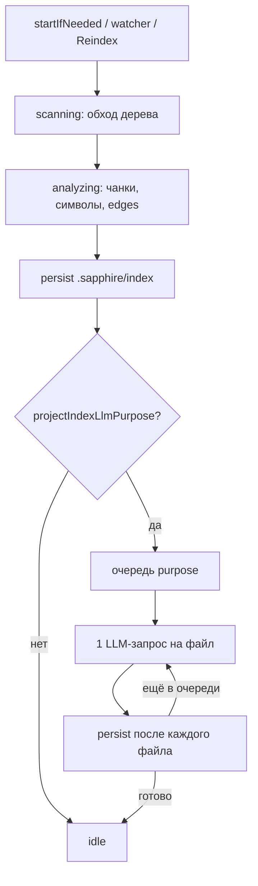

# Индекс проекта (`.sapphire/index`)

Гибридный индекс workspace: локальный разбор файлов (чанки, символы), опционально LLM-purpose через шлюз. Агент ищет по индексу tool’ом `search_project_index` (Plan/Agent).

Пользовательский обзор: [Контекст и @-упоминания](/guide/context#индекс-проекта-sapphire-index).

## Пайплайн

Фазы статуса: `scanning` → `analyzing` → `purpose` (если включено) → `idle` / `error`.

| Фаза        | Что делает                                                                 | LLM |
| ----------- | -------------------------------------------------------------------------- | --- |
| scanning    | обход workspace, фильтр skip-директорий и бинарных расширений              | нет |
| analyzing   | текст/office/csv → чанки; TS/JS — структура (символы, imports/calls); прочие языки — regex или DocumentSymbol; `layer`, edges | нет |
| purpose     | короткий JSON: `purpose`, `tags`, `when_useful`                            | да  |

Прогресс UI: scanning ≈ 0–5%, analyzing ≈ 5–80% (или 0–100% без purpose), purpose ≈ 80–100%.

## Когда запускается

| Триггер                         | Режим          |
| ------------------------------- | -------------- |
| Открытие workspace / enable     | incremental    |
| Изменение файлов (debounce 1.5 с) | incremental  |
| `Sapphire: Reindex Workspace`    | full           |
| Resume после Pause              | incremental + оставшийся purpose |

Инкремент: переразбираются изменившиеся файлы (по hash). Purpose перезапрашивается только для `pending` / `failed` или при смене hash; при `done` и том же hash — пропускается. Full reindex заново гоняет purpose для всех не-`skipped`.

Pause/Cancel останавливает очередь и блокирует автозапуск, пока пользователь не сделает Resume или Reindex.

## LLM-purpose

- Вкл/выкл: `projectIndexLlmPurpose` (Settings → «LLM-purpose», по умолчанию вкл.).
- Модель: `modelSelectionOfFeature.SCM` (часто синхронизирована с Chat через `syncSCMToChat`).
- Параллелизм: **1** запрос за раз (`PURPOSE_CONCURRENCY = 1`).
- На файл: excerpt чанков (до ~1800 символов) + имена символов; ответ — компактный JSON.
- Секретные пути (`.env`, credentials, `*.pem` / `*.key` и т.п.) → `llmStatus: skipped`, на шлюз не уходят.

## Файлы на диске

Каталог: `<workspace>/.sapphire/index/` (строка `.sapphire/index/` добавляется в `.gitignore`). Persist пишет все пять файлов разом после analyze и снова после каждого успешного LLM-purpose.

### `manifest.json`

Сводка индекса, не сами данные поиска.

| Поле | Смысл |
| --- | --- |
| `schemaVersion` | версия формата (**3**, `PROJECT_INDEX_SCHEMA_VERSION`); при несовпадении индекс отбрасывается и собирается заново |
| `root` | корень workspace |
| `builtAt` / `lastFullAt` / `lastIncrementalAt` | когда индекс строили (полный / инкремент) |
| `counts` | числа files / chunks / symbols / edges, разбивка `byKind`, счётчики purpose (`done` / `pending` / `failed`) |

**Зачем:** UI статуса («проиндексирован», прогресс), быстрая проверка актуальности без чтения jsonl, resume инкремента.

### `files.jsonl`

JSONL: одна запись = один файл workspace.

| Поле | Смысл |
| --- | --- |
| `path`, `mtime`, `size`, `kind`, `hash` | идентификация и детект изменений для инкремента |
| `layer` | слой по пути: `browser`, `electron-main`, `common`, `node`, `test`, `docs`, `other` |
| `localRole` | эвристика по пути/символам (без LLM) |
| `purpose` | короткое «зачем файл» от LLM |
| `tags` | до 8 тегов |
| `whenUseful` | когда открывать файл |
| `llmStatus` | `pending` \| `done` \| `failed` \| `skipped` |
| `error`, `updatedAt` | ошибка purpose / время обновления записи |

**Зачем:** каталог файлов для `search_project_index` (score по path, purpose, localRole, tags, whenUseful) и очередь LLM-purpose.

### `chunks.jsonl`

Фрагменты текста: `path`, `anchor`, `text` (код, office/csv и т.п. после локального разбора).

**Зачем:** полнотекстовый token-score по содержимому; в hit можно указать якорь релевантного куска, не подтягивая весь файл в индекс-поиск.

### `symbols.jsonl`

Для TS/JS — структурный разбор файла: функции, классы, методы, константы с настоящими `startLine` / `endLine` и опциональным `owner`. Для остальных языков — regex по export, а если модель открылась, outline DocumentSymbol (до 80). Поле `owner` есть у методов.

**Зачем:** поиск по именам классов, функций, методов; якорь хита — диапазон строк символа.

### `edges.jsonl`

Рёбра с типом:

| `type` | Смысл |
| --- | --- |
| `imports` | файл импортирует другой файл внутри workspace. Относительный спецификатор `.js`/`.jsx`/`.mjs`/`.cjs` резолвится в `.ts`/`.tsx`/`.mts`/`.cts`; префикс `vs/...` — в `src/vs/...`. `import type` / `export type … from` рёбер не дают. Пакеты из `node_modules` ребром не становятся. Для `.html`/`.htm` — локальные `href`/`src` у `link`, `script`, `img`; для `.css`/`.scss`/`.less` — `@import` и `url(...)` на файлы workspace |
| `contains` | файл содержит символ (`toSymbol`) |
| `calls` | символ (`fromSymbol`) вызывает символ репозитория (`toSymbol` на `toPath`). Неразрешённый вызов не записывается |

**Зачем:** граф для `diff_impact` и навигации «кто импортирует / кто вызывает».

Схема `PROJECT_INDEX_SCHEMA_VERSION` = **3**. Индекс прошлой версии при загрузке отбрасывается и собирается заново.

## Поиск и охват изменений

`search_project_index` — локальный token-score по path, purpose, localRole, tags, whenUseful, символам и чанкам. Страницы по ~20 hits. Имена и строки символов берутся из структурного разбора.

`diff_impact` — BFS до **2 hops** по `imports` и `calls` от переданных относительных путей: затронутые файлы и символы (`hops`), плюс слои. Тот же расчёт подмешивается в генерацию commit message (секция graph impact). `contains` внутри изменённого файла соседом не считается.

### `tour.json`

Опциональный guided tour онбординга (не часть schemaVersion). Генерируется одним LLM-запросом (модель SCM) из компактной сводки: слои, до ~80 файлов с purpose/localRole, до ~60 рёбер `imports`/`calls`. Кнопка в карточке индекса запускает его вручную. После очереди LLM-purpose, если тура нет или он stale, сервис запускает генерацию один раз на этот purpose-batch.

| Поле | Смысл |
| --- | --- |
| `generatedAt` | когда тур собрали |
| `basedOn` | `{ files, edges, purposeDone }` на момент генерации — для детекта stale |
| `steps[]` | `order`, `title`, `description`, `paths[]` (1–5 путей из индекса), опционально `symbols[]` |

Агент читает тур tool’ом `get_project_tour`. Полный reindex и несовпадение schema удаляют тур. Инкремент тур не трогает; UI помечает stale, если counts сильно разъехались.

## Настройки

| Setting                     | Дефолт | Роль                          |
| --------------------------- | ------ | ----------------------------- |
| `projectIndexEnabled`       | true   | фоновый индекс                |
| `projectIndexIncludeOffice` | true   | xlsx/docx/pptx/pdf в индексе  |
| `projectIndexLlmPurpose`    | true   | очередь purpose через шлюз    |

## Ключевые файлы

| Файл                                                         | Роль                                |
| ------------------------------------------------------------ | ----------------------------------- |
| `browser/projectIndexService.ts`                             | оркестрация, persist, LLM-purpose   |
| `common/projectIndex/projectIndexTypes.ts`                   | типы, schemaVersion, пути           |
| `common/projectIndex/projectIndexAnalyze.ts`                 | skip/kind/hash/localRole/слой/чанки |
| `common/projectIndex/projectIndexStructure.ts`               | структурный разбор TS/JS            |
| `common/projectIndex/projectIndexImpact.ts`                  | diff-impact до 2 hops               |
| `common/projectIndex/projectIndexTour.ts`                    | промпт/parse тура онбординга        |
| `common/projectIndex/projectIndexSearch.ts`                  | scoring для tool                    |
| `browser/vue/.../ProjectIndexControls.vue`                 | UI статуса / детали                 |
| `browser/projectIndexTitlebarContribution.ts`                | индикатор в titlebar                |
