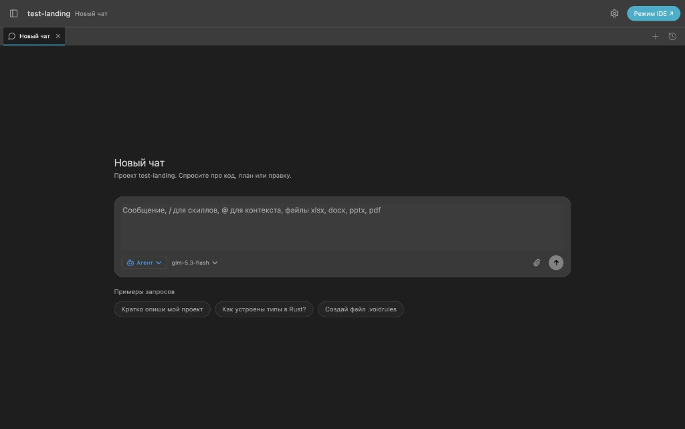

# Онбординг

При первом запуске Sapphire показывает экран онбординга.

## Шаги

### 1–3. Провайдер и проверка

1. Выберите провайдера и введите ключ или endpoint.
2. IDE запрашивает список моделей у этого провайдера.
3. При успехе ключ сохраняется зашифрованно, подставляются модели по фичам.

### 4. Выбор layout

Выберите layout: **Режим IDE** или **Режим Агент** (можно сменить позже в Settings) — см. [Режим Агент](/guide/agents-layout).

### 5. Workbench

Открывается workbench (или оверлей Агента) с чатом.

**Режим Агент** — полноэкранный чат:

**Режим IDE** — классический редактор и сайдбар ассистента.

## Если токен не принят

См. [Токен и ошибки](/intro/token-and-errors). После исправления можно снова открыть онбординг или ввести ключ в **Settings → Провайдеры**.

## Смена ключа позже

**Settings → Провайдеры**. Список моделей обновится автоматически.
